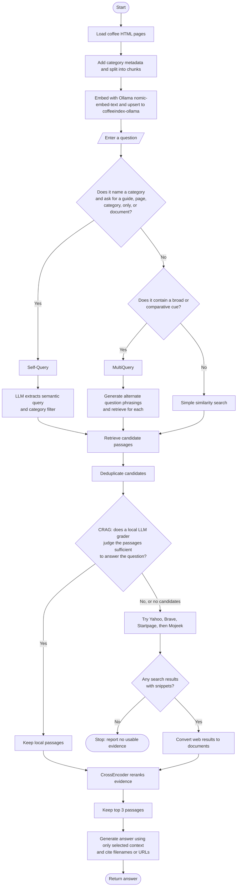

# Adaptive RAG and CRAG Flow

This diagram follows [`adaptive_rag_learning.py`](./adaptive_rag_learning.py). The
router selects one retrieval strategy; CRAG then checks whether the retrieved
evidence is enough before the final answer is generated.

## What question takes each route?

| Route | When the router chooses it | Example question | What retrieval does |
|---|---|---|---|
| Simple similarity | The question is direct and has no special routing cue | “How is cold brew coffee made?” | Searches Pinecone for semantically similar chunks. |
| MultiQuery | The question is broad or comparative; it includes cues such as “compare”, “difference”, “recommend”, or “options” | “Compare different coffee brewing methods.” | Uses the local LLM to produce alternate phrasings, searches for them, and includes the original question. |
| Self-Query | A known category (`cold_brew`, `espresso`, or `pour_over`) appears alongside a metadata cue such as “guide”, “page”, “only”, or “document” | “Find the cold brew guide.” | Uses the LLM to build a semantic query and a Pinecone metadata filter. |

## CRAG correction scenarios

- **Local evidence is sufficient:** CRAG keeps the retrieved local passages. It
  skips web search, then reranks the passages and answers from the top three.
- **Local evidence is insufficient or retrieval found nothing:** CRAG searches
  Yahoo, Brave, Startpage, then Mojeek in order. It stops at the first provider
  with usable results, converts results with snippets into evidence documents,
  reranks them, and answers from the top three search results.
- **No usable web snippets:** The program stops without generating an answer
  from unsupported context.

The routing rules are keyword-based in this learning example. The CRAG evidence
decision is made by the local Ollama model. When the web fallback runs, the
question is sent to each provider attempted until one returns usable results.
Embeddings use Ollama's `nomic-embed-text` model and the separate Pinecone index
`coffeeindex-ollama`; pull the model with `ollama pull nomic-embed-text` first.
The CrossEncoder reranker still downloads its model from Hugging Face.
